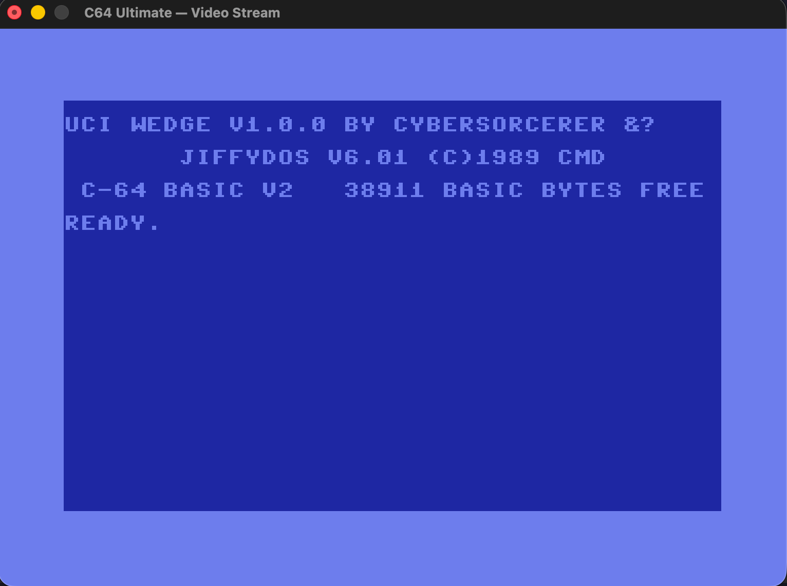
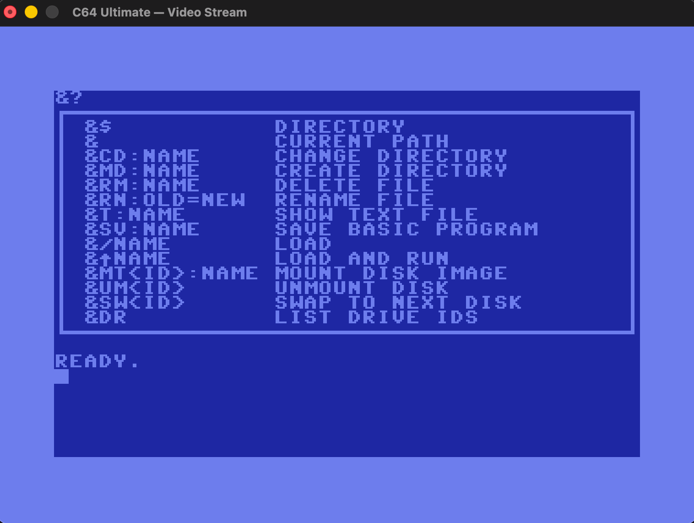

# c64u - Commodore C64 Ultimate CLI

A command-line interface for controlling the [Commodore C64 Ultimate](https://commodore.net) via its REST API written in Go. c64u is primarily intended for those of you who want to develop for the Commodore C64 Ultimate with VS Code or Neovim, or who want to create small automations with scripting languages. A development environment with full CLI integration in Neovim can be found in the [c64.nvim project](https://github.com/cybersorcerer/c64.nvim). A plugin for VSCode including a Tree Browser is in the making.

## Features

- **Complete REST API Coverage**: All C64 Ultimate API endpoints supported
- **Interactive TUI**: Full-screen terminal UI with a dual-pane file browser, drive, machine and config views
- **SoftIEC Control**: Load from the Ultimate filesystem at the BASIC prompt — no disk image needed; enable the DOS emulation drive, set its device number, and point it at a directory
- **Live Video Stream**: Display C64 video output in a native window that is also the C64's keyboard, joystick and mouse — type into BASIC, play games with a gamepad, use GEOS with the mouse, drive the Ultimate menu and its machine code monitor (firmware 1.2.0 / 3.15; older firmware falls back to the keyboard buffer)
- **Live Audio Stream**: Play back C64 audio in real time
- **FTP Integration**: Access the C64 Ultimate filesystem, and add remote FTP servers - a NAS, another computer - whose disk images and programs the device then mounts and runs like its own (firmware 1.2.1)
- **Power Control**: Switch the machine off, and on again over the network with Wake-on-LAN
- **Flexible Configuration**: Config file, environment variables, or CLI flags
- **Multiple Output Formats**: Human-readable text or JSON for scripting
- **Debug Logging**: Built-in debug mode for troubleshooting
- **Cross-Platform**: Builds for macOS, Linux, and Windows
- **Easy Integration**: Works seamlessly with c64.nvim, VSCode, and scripts
- **Agent Skills**: Portable C64 knowledge packs for AI coding agents — Claude Code, opencode, pi, Hermes and others
- **Ultimate Wedge**: A cartridge that adds directory, load, save, copy, text-viewing, disk-mount, memory-dump and REU-image commands to stock BASIC, straight onto the Ultimate filesystem

## What's New in v1.2.0

Most of this needs firmware 1.2.1 on the C64 Ultimate; the commands say so when the device is
older.

**New**

- **Switch the machine on over the network** — `c64u machine poweron` sends a Wake-on-LAN packet
  and waits until the device answers. It needs a one-time setup on the device and the Wi-Fi MAC
  in `config.toml`: see [Switching Off and On Over the Network](#switching-off-and-on-over-the-network).
- **Remote FTP servers** — `c64u fs servers add` makes a NAS or another computer appear on the
  device under `/ftp/<alias>/`, so `drives mount` and `runners run-prg` take images and programs
  straight from it. The device reads the list when it is switched on.
- **SoftIEC partitions** — `c64u drives softiec partitions set` saves which directories SoftIEC
  serves; the device loads them when it is switched on, or at once from the Ultimate menu.
- **Video window as keyboard, joystick and mouse** — keys are held like on real hardware, so games,
  the Ultimate menu and the machine code monitor work, not only BASIC; gamepads are joysticks;
  the mouse works in GEOS.
- **Configuration backup** — `c64u config restore` puts a backup from `config export` back and
  saves it to flash; `c64u config import` copies a setup onto a second device.
- `c64u machine read-mem --disasm` disassembles, illegal opcodes included.
- `c64u machine input` drives the mouse: `move:X,Y`, `tap:mouse:left`, the wheel.
- `c64u machine heap`, `c64u drives unlink`.
- `c64u config save-to-flash`, `load-from-flash` and `reset-to-default` take a category.
- Wedge 1.1.0 — `@CP` copies a file, `@SM` saves the 64 KB RAM to a file, `@RL`/`@RS` load and
  save the REU image.
- `c64u info` shows the Ethernet and Wi-Fi MAC addresses; `c64u cli-config show` shows the
  configured `wifi_mac`.

**Changed** — check these if you script against `c64u`:

- `c64u files pack-d64` leaves `.prg`, `.seq`, `.usr` and `.rel` out of the C64 file name; that
  information is in the file type. `hello.prg` is now loaded with `LOAD"HELLO",8`, not
  `LOAD"HELLO.PRG",8`. Other extensions stay part of the name.
- In the video window **Esc is RUN/STOP**. It used to arm a reset; resetting is now Mod+R pressed
  twice.
- `c64u machine poweroff` first remembers the Wi-Fi MAC for `poweron` and warns when Wake On
  Wi-Fi is off.
- Text output prints nested values as indented lists with sorted keys instead of Go's `map[...]`
  notation. `--json` output is unchanged.
- `streams listen` retries a refused start for 6 seconds instead of 90, then explains a
  "Network Host Resolve Error" — see [Troubleshooting](#troubleshooting).
- The Linux ARM64 binary now has the video and audio stream too; all Linux builds load the
  graphics and sound libraries only when a stream opens.

**Fixed**

- The debug stream trace printed the GAME, EXROM, IRQ and NMI signals inverted; it now prints
  them when they are asserted. Trace output is buffered and drops fewer packets.
- The video window resends held keys after a reset, no longer types stray characters for dead
  keys, and retries while the device is still releasing the previous stream.
- The TUI's Streams tab shows why a stream failed to start.

## The Ultimate Wedge

A C64 out of the box cannot reach the Ultimate filesystem from the `READY`
prompt. You browse it from the device menu, or you build a disk image. The wedge
in [`c64/wedge`](c64/wedge/README.md) removes that detour:

```
@?            show the command table     @          show the current path
@$            list the directory         @DR        list the drive ids
@CD:NAME      change directory           @MD:NAME   create directory
@RM:NAME      delete a file              @T:NAME    show a text file
@RN:OLD=NEW   rename a file              @SV:NAME   save the BASIC program
@/NAME        load                       @↑NAME     load and run
@MT<id>:NAME  mount a disk image         @UM<id>    unmount the disk
@SW<id>       swap to the next disk      @V         show the version
@TI           show date and time         @DA<0/1>   drive A off, on
@DB<0/1>      drive B off, on            @RL / @RS  load / save the REU image
@CP:NAME=DIR  copy into a directory      @SM[:PATH] save 64K RAM to a file
```

`@CP`, `@SM`, `@RL` and `@RS` need firmware 1.2.1.

`<id>` is the drive's bus id and may be left out. It is set per drive in the
Ultimate's configuration, so it differs between machines and drive A is not
always 8 — run `@DR` to see the ids yours uses rather than assuming a number.

On a JiffyDOS machine every `@` above becomes `&` — `&DR`, `&T:NAME`, `&/NAME`.
The cartridge decides that at boot and prints the live prefix in its own table.

It ships as a cartridge, so it is there from power-on — the Ultimate has no
boot-PRG setting — and it uses the [Ultimate Command Interface](skills/c64-knowledge/references/uci.md)
rather than SoftIEC, so every command acts on the same directory. Listing
does not overwrite the BASIC program in memory the way `LOAD"$"` does.

It is a Magic Desk cartridge that unmaps itself once installed, so BASIC still
reports all 38911 bytes free. On a JiffyDOS machine, where `@`, `/` and `↑` are
already taken, it detects that at boot and moves its commands behind `&` — both
can be installed at once.

`wedge.crt` ships with every [release](https://github.com/cybersorcerer/c64u/releases),
so installing it needs no build tools:

```sh
c64u fs upload wedge.crt /Flash/carts/wedge.crt
c64u config set "C64 and Cartridge Settings" Cartridge wedge.crt
c64u config save-to-flash
```

Building it from source instead needs Kick Assembler and Go:

```sh
make -C c64/wedge run       # try it, until the next reboot
make -C c64/wedge install   # copy it into /flash/carts
```

The cartridge announces itself on one line above BASIC's own start-up message,
where JiffyDOS puts its banner, and names the prefix that is live on the machine
it just booted on:



`@?` prints the command table — here on the same JiffyDOS machine, where the
wedge has detected it and moved itself behind `&`:



See [`c64/wedge/README.md`](c64/wedge/README.md) for installation, the JiffyDOS
question, and what was verified on real hardware.

## Installation

### Download Pre-built Binaries (Recommended)

Download the latest release from [GitHub Releases](https://github.com/cybersorcerer/c64u/releases/latest):

- `c64u_Darwin_x86_64.tar.gz` - macOS (Intel)
- `c64u_Darwin_arm64.tar.gz` - macOS (Apple Silicon)
- `c64u_Linux_x86_64.tar.gz` - Linux (x86_64)
- `c64u_Linux_arm64.tar.gz` - Linux (ARM64)
- `c64u_Windows_x86_64.tar.gz` - Windows

**Quick Install (macOS/Linux):**

```bash
# Download and extract (replace with your platform)
curl -L https://github.com/cybersorcerer/c64u/releases/latest/download/c64u_Darwin_arm64.tar.gz | tar xz

# Move binary to PATH
mv c64u ~/.local/bin/

# Verify installation
c64u version
```

**Windows:**

1. Download `c64u_Windows_x86_64.tar.gz`
2. Extract `c64u.exe`
3. Add the directory to your PATH

### From Source

```bash
git clone https://github.com/cybersorcerer/c64u.git
cd c64u/tools/c64u

# Build and install to ~/.local/bin
make install
```

## Prerequisites

- Go 1.25 or later (for building from source)
- C64 Ultimate hardware on your network

## Quick Start

### 1. Create Configuration File

```bash
c64u cli-config init
```

This creates `~/.config/c64u/config.toml` with default settings.

### 2. Edit Configuration

```toml
# ~/.config/c64u/config.toml
host = "192.168.1.100"
port = 80
```

### 3. Test Connection

```bash
c64u about        # C64 Ultimate API version
c64u info         # Device information
```

## Configuration

### Several Devices

More than one C64 Ultimate can be described in the config file, each under a
name, and `--device` (short `-D`) picks which one a command talks to:

```toml
default = "living-room"

[devices.living-room]
host = "192.168.1.100"
port = 80

[devices.attic]
host = "c64u-attic.local"
```

```bash
c64u info                        # the "default" entry
c64u --device attic info         # a specific one
c64u -D attic runners run-prg-upload game.prg
C64U_DEVICE=attic c64u info      # for a whole shell session
```

`c64u cli-config show` lists the configured devices and marks the one in use.
A name that is not defined stops the command and reports the names that are —
it never falls back to another machine.

With exactly one device defined, it is used without `default`. A config file
using the older flat `host = "..."` form keeps working unchanged.

### Priority Order

1. **CLI Flags** `--host 192.168.1.100 --port 80`
2. **Environment Variables** `C64U_HOST`, `C64U_PORT`, `C64U_DEVICE`, `C64U_PASSWORD`
3. **`--device`**, naming an entry in the config file
4. **Config File** `~/.config/c64u/config.toml`
5. **Default** port=`80`

There is deliberately **no default host**. A C64 Ultimate is always a separate
machine on the network, so `localhost` could only ever be wrong: with nothing
configured, `c64u` stops and says so instead of reporting a connection timeout
against your own computer.

### Wi-Fi MAC for Wake-on-LAN

`c64u machine poweron` switches the device on with a Wake-on-LAN packet for its
**Wi-Fi** MAC address. A switched-off device cannot tell its address, so put it
into the config file while the device is on:

```bash
c64u info                    # look for "Wi-Fi MAC: 9C:13:9E:ED:D5:EC"
```

```toml
# ~/.config/c64u/config.toml - flat form
host = "192.168.1.100"
wifi_mac = "9C:13:9E:ED:D5:EC"

# or per device
[devices.living-room]
host = "192.168.1.100"
wifi_mac = "9C:13:9E:ED:D5:EC"
```

Take the **Wi-Fi MAC**, not the Ethernet MAC: the device wakes only on Wi-Fi.
`c64u cli-config show` shows the `wifi_mac` it will use. `--mac` on the command
line outranks it. Without either, `poweron` uses the address `machine poweroff`
remembered. `wifi_mac` belongs to its device, so a one-off `--host` does not use it.
The device side needs setting up once too; see
[Switching Off and On Over the Network](#switching-off-and-on-over-the-network).

### Network Password

If the device has a network password set (Network Settings in the Ultimate
menu), give it to `c64u` in one of these ways, highest priority first:

```bash
c64u --password secret info          # visible in the process list
export C64U_PASSWORD=secret          # preferred for scripts
```

```toml
# ~/.config/c64u/config.toml - top level, or per device
password = "secret"

[devices.attic]
host = "c64u-attic.local"
password = "other-secret"
```

The password is sent as the `X-Password` header on every REST request and as
the FTP password for file browsing. It is stored in clear text in the config
file, so `c64u cli-config init` creates that file readable by you only; keep
it that way. If your config file predates this, run
`chmod 600 ~/.config/c64u/config.toml`. `c64u cli-config show` reports only
whether a password is set. A selected device uses only its own password, never
the top-level one, and `C64U_PASSWORD` or `--password` override it. With a
missing or wrong password the device answers 403 and `c64u` says so.

## Usage

### Global Flags

```bash
--host string      C64 Ultimate hostname/IP (env: C64U_HOST)
--device, -D name  Device defined in the config file (env: C64U_DEVICE)
--port int         HTTP port, default 80 (env: C64U_PORT)
--password string  Network password of the device (env: C64U_PASSWORD)
--json             Output in JSON format
--verbose          Show HTTP requests/responses
--debug, -d        Debug logging to ~/.local/share/c64u/c64u.log
--no-color         Disable colored output
```

### Shell Completion

```bash
c64u completion zsh > "${fpath[1]}/_c64u"        # zsh
c64u completion bash > /etc/bash_completion.d/c64u
c64u completion fish > ~/.config/fish/completions/c64u.fish
```

### Commands

#### Interactive TUI

```bash
c64u ui
```

Full-screen terminal UI, organised as five tabs:

- **Files**: Dual-pane browser — your machine on the left, the C64 Ultimate on the right. Copy between them, run programs, mount images
- **Drives**: Mount/unmount, load ROMs, enable/disable drives, SoftIEC directory and device number
- **Machine**: Reset, reboot, pause/resume, menu button, power off
- **Config**: Browse and edit device settings, save/load from flash
- **Streams**: Start the video, audio or debug stream

The TUI covers the commands as they were before firmware 1.2.1. The newer ones - `machine input`,
`machine menu-screen`, `read-mem --disasm`, `config restore`/`import`, per-category flash
operations, `drives unlink`, `drives softiec partitions`, `fs servers`, `machine heap` and
`machine poweron` - are command-line only for now.

Global keys, in every view:

| Key | Action |
| --- | --- |
| `1`–`5` | Jump to tab |
| `Ctrl+h` / `Ctrl+l` | Previous / next tab |
| `j` / `k`, `↑` / `↓` | Move down / up |
| `g` / `G` | Top / bottom |
| `Ctrl+d` / `Ctrl+u` | Half page down / up |
| `Enter` | Select / open |
| `?` | Help overlay |
| `Esc` | Back / close |
| `Ctrl+C` | Quit |

File browser:

| Key | Action |
| --- | --- |
| `Tab`, `h` / `l` | Switch active pane (local/remote) |
| `Enter` | Open directory, disk actions, or run PRG/CRT/SID/MOD |
| `Backspace` | Parent directory |
| `Space` | Mark file for a batch operation |
| `F5` or `c` | Copy marked files to the other pane |
| `d` / `r` / `m` | Delete / rename / make directory |
| `n` | New disk image (remote pane) |
| `u` | Apply to a drive: mount disk image, or load ROM |
| `p` | Toggle the preview column |

File viewer:

| Key | Action |
| --- | --- |
| `Tab` | Toggle text / hex view |
| `PgUp` / `PgDn` | Scroll page by page |
| `Esc` / `q` | Back to the file browser |

In the Streams tab, video opens its own window and audio plays in the background; a stream that
fails to start shows the device's error in the status line. The debug stream suspends the TUI,
hands the terminal to the stream viewer, and returns you to the same tab when it exits.

#### Data Streams (C64 Ultimate Only)

```bash
# Live listeners — auto-detect local IP, start stream, stop on Ctrl+C
c64u streams listen video                      # C64 video in a native window
c64u streams listen audio                      # C64 audio through speakers
c64u streams listen debug                      # Raw debug stream to stdout
c64u streams listen debug --raw | xxd          # Pipe to other tools

# Override local IP
c64u streams listen video --ip 192.168.1.50

# Manual start/stop
c64u streams start <stream> <ip>
c64u streams stop <stream>
```

**Streams:** `video` (port 11000), `audio` (port 11001), `debug` (port 11002)

`video` and `audio` open a window and need the graphics and sound libraries of the host; the
macOS, Windows and Linux binaries load them when the stream starts. `debug` is plain output and
works everywhere.

**Video Stream**: Opens a native 768×544 window (2× scaled) with accurate VIC colors. PAL (384×272) and NTSC (384×240) supported.

While the video window has focus it is the C64's keyboard, joystick and mouse. Keys are held as
long as you hold them, so games, the Ultimate menu and its machine code monitor work as well as
BASIC. This uses the REST API's `machine:input`, which came with firmware 1.2.0 on the C64
Ultimate and 3.15 on the other Ultimates. On older firmware the window falls back to typing into
the KERNAL keyboard buffer, which only BASIC and other buffer readers see, and says so in its
title.

**Keyboard** — two modes, switched with Mod+K:

- **character** (default): what your keyboard layout types arrives on the C64, whatever the
  layout — `"` is Shift+2 on the C64, `@` is typed with AltGr / right Option as usual. Characters
  the C64 lacks (ä, ß, €, …) are ignored.
- **position**: the C64 key in the same place as yours, held as long as you hold it. Use it for
  games: in character mode every typed character is a short key press, so a held key follows
  your system's key repeat and stutters in a game that reads the keyboard itself.

| Key                              | C64                                  |
| -------------------------------- | ------------------------------------ |
| Left Alt / Option                | C= (Commodore)                       |
| Right Alt / Option (AltGr)       | your layout's symbols (@ [ ] …)      |
| Ctrl, Tab                        | CTRL                                 |
| Esc                              | RUN/STOP                             |
| Page Up                          | RESTORE                              |
| Return, Backspace, Home          | RETURN, INST/DEL, CLR/HOME           |
| Cursor keys                      | cursor keys (up and left with Shift) |
| F1–F8                            | F1–F8 (even keys with Shift)         |

**Joystick** — gamepads in the standard layout (an Xbox controller, for example) are joysticks:
the first on port 2, the second on port 1. D-pad or left stick move, A is fire, B is fire 2, X is
Space and Menu is RUN/STOP. Mod+J turns the keyboard into a joystick too (arrows, left Ctrl =
fire). Mod+P swaps the ports.

**Mouse** — Mod+L captures the pointer; motion, buttons and wheel then go to the C64 mouse on
port 1 (as in GEOS). While it is captured a joystick on port 1 is ignored. Port 1 shares its
lines with the keyboard matrix, so at the BASIC prompt a click reads as a key press (the left
button types a space), as on a real C64; programs that use the mouse read it themselves.

**Hotkeys** — the modifier is Cmd on macOS and Ctrl+Shift on Windows and Linux. Letters follow
your layout's labels.

| Hotkey | Action                                                                  |
| ------ | ----------------------------------------------------------------------- |
| Mod+K  | switch keyboard mode                                                    |
| Mod+J  | keyboard joystick on/off                                                |
| Mod+P  | swap joystick ports                                                     |
| Mod+L  | capture or release the mouse                                            |
| Mod+U  | open or close the Ultimate menu (F1 › Developer › Machine Code Monitor) |
| Mod+R  | reset the C64, pressed twice within a second                            |

Losing focus or closing the window releases everything the window was holding.

**Tested on** — macOS with a German keyboard, an Xbox controller and a trackpad, against a C64
Ultimate on firmware 1.2.1. The Windows and Linux builds are compiled from the same code and the
Linux window opens under GNOME on Wayland, but keyboard, gamepad and mouse are untested there, as
are other keyboard layouts (US, French, …). If you try them, please report what works and what
does not in the [issues](https://github.com/cybersorcerer/c64u/issues): your system, your
layout, and what arrived on the C64 (`c64u machine read-mem 0400 --length 40` shows the first
screen line).

**Audio Stream**: Plays 48 kHz stereo 16-bit PCM from the C64 audio mixer with automatic gap compensation.

**Debug Stream**: Streams raw 6510/VIC/1541 CPU bus data for clock-cycle-accurate program tracing (firmware ≥ 3.7 required).

```bash
c64u streams listen debug --tui                # Live disassembler TUI
```

The `--tui` flag opens a full-screen live disassembler that decodes the 6510 bus trace in real time:

- **Live disassembly** of code running on the C64, including all illegal opcodes
- **CPU registers**: PC, SP and reconstructed status flags (N V B D I Z C)
- **I/O access log**: live VIC, SID and CIA register reads/writes
- Kernal ROM ($E000–$FFFF) and BASIC ROM ($A000–$BFFF) are filtered out to keep the trace focused on user code

| Key | Action |
| --- | --- |
| `Space` | Pause / resume |
| `↑/k`, `↓/j` | Scroll (paused) |
| `fn+↑/u`, `fn+↓/d` | Page up / down (paused) |
| `q` / `Ctrl+C` | Quit |
| `w` | Add watchpoint (enter: `D020` or `D020=05`) |
| `W` | Remove last watchpoint |

**Watchpoints** monitor any number of memory addresses live:

- Address only (`D020`): logs every write with value and hit counter
- With value condition (`D020=05`): auto-pauses when exactly that value is written
- The watchpoint panel shows address, last value, hit counter, and condition status

#### Runners — Media & Program Execution

```bash
c64u runners sidplay <file> [--song N]         # Play SID from C64U filesystem
c64u runners sidplay-upload <file> [--song N]  # Upload and play SID
c64u runners modplay <file>                    # Play MOD
c64u runners modplay-upload <file>             # Upload and play MOD
c64u runners load-prg <file>                   # Load PRG via DMA
c64u runners load-prg-upload <file>            # Upload and load PRG
c64u runners run-prg <file>                    # Load and run PRG
c64u runners run-prg-upload <file>             # Upload and run PRG
c64u runners run-crt <file>                    # Start cartridge
c64u runners run-crt-upload <file>             # Upload and start cartridge
```

#### Machine Control

```bash
c64u machine reset                             # Reset machine
c64u machine reboot                            # Reboot with cartridge reinit
c64u machine pause                             # Pause via DMA
c64u machine resume                            # Resume from pause
c64u machine poweroff                          # Power off, remembering the Wi-Fi MAC
c64u machine poweron [--mac MAC] [--no-wait]   # Wake-on-LAN, waits until it answers
c64u machine menu-button                       # Simulate Menu button press
c64u machine menu-screen                       # Read the open Ultimate menu as text (fw 1.2.0)
c64u machine write-mem <addr> <data>           # Write hex data to memory
c64u machine write-mem-file <addr> <file>      # Write file to memory
c64u machine read-mem <addr> [--length N]      # Read memory (hex dump)
c64u machine read-mem <addr> --to <addr>       # Read an address range, end inclusive
c64u machine read-mem <addr> --output <file>   # Write the raw bytes to a file (-o)
c64u machine read-mem <addr> --raw             # Write the raw bytes to stdout
c64u machine read-mem <addr> --disasm          # Disassemble (6502, illegal opcodes too)
c64u machine sendkey <string> [--delay <ms>]   # Send keystrokes to keyboard buffer
c64u machine input <event...>                  # Keys, joysticks, mouse at the hardware level
c64u machine input move:300,-40 tap:mouse:left # Move the mouse, click (fw 1.2.1)
c64u machine heap                              # Firmware heap statistics (fw 1.2.1)
c64u machine debug-reg                         # Read debug register (U64 only)
c64u machine debug-reg-set <value>             # Write debug register (U64 only)
```

**Reading memory** (`read-mem`) shows a hex dump by default. `--output` (`-o`)
writes the bytes to a file and `--raw` writes them to standard output, both
exactly as the C64 returned them — neither adds or removes anything. Given
together they do both, like `tee`. Either combines with `--length` or `--to`,
in text and JSON mode alike:

```bash
c64u machine read-mem 0400 --to 07e7 --output screen.bin   # screen RAM, 1000 bytes
c64u machine read-mem 0000 --to ffff -o memory.bin         # whole address space
c64u machine read-mem 0400 --length 16 --raw | xxd         # pipe the bytes
c64u machine read-mem 0400 --to 07e7 -o screen.bin --raw | xxd   # file and pipe
```

With `--raw`, standard output carries the memory and nothing else — not even a
confirmation of a file written alongside it, so a pipeline stays clean.

`--to` is inclusive, so `0400 --to 07e7` is the full 1000-byte screen. Addresses
may be written as `0400`, `$0400` or `0x0400`, and are checked before the
request goes out — the device answers an invalid address with data from
somewhere rather than an error.

**Keyboard injection** (`sendkey`) converts ASCII strings to PETSCII and injects them into the C64 keyboard buffer via DMA. Strings longer than 10 characters are sent in chunks (default 100ms delay). Escape sequences: `\n` (Return), `\f1`–`\f8` (F1–F8), `\clr`, `\del`, `\home`, `\cup` (cursor up), `\cdn` (cursor down), `\cleft` (cursor left), `\cright` (cursor right).

> **Note — `\stop` (RUN/STOP):** The sequence `\stop` writes PETSCII `$03` into the keyboard buffer. This only works when the C64 is idle (e.g. at the BASIC prompt or waiting for `INPUT`). While a BASIC program is running, the BASIC ROM reads the RUN/STOP state directly from the CIA1 hardware register at `$DC01` — not from the keyboard buffer. DMA writes cannot reach I/O-mapped CIA registers, so `\stop` has no effect on a running program.

#### Switching Off and On Over the Network

`machine poweroff` switches the C64 Ultimate off; `machine poweron` switches it
on again with a Wake-on-LAN packet. The device wakes only over **Wi-Fi**, and
only with **Wake On Wi-Fi** enabled and saved — it is off by default. Set it up
once, with the device on:

1. **Connect the device to your Wi-Fi network** in the Ultimate menu, in the same
   network as the computer running `c64u`. A cable may stay plugged in as well;
   the packet is a broadcast and has to reach the device's Wi-Fi.
2. **Enable Wake On Wi-Fi and save it to flash.** Set in memory only, it is gone
   after the next power-off:

   ```bash
   c64u config set "U64 Specific Settings" "Wake On Wi-Fi" Enabled
   c64u config save-to-flash "U64 Specific Settings"
   ```

3. **Put the Wi-Fi MAC into `config.toml`.** `c64u info` shows it as `Wi-Fi MAC`;
   add `wifi_mac = "9C:13:9E:ED:D5:EC"` next to the device's `host` — see
   [Wi-Fi MAC for Wake-on-LAN](#wi-fi-mac-for-wake-on-lan). This step can be left
   out: `machine poweroff` remembers the address in `~/.config/c64u/wifi_macs.json`,
   but only for a device it switched off itself, and only on that computer.
4. **Try it:**

   ```bash
   c64u machine poweroff       # warns if Wake On Wi-Fi is still off
   c64u machine poweron        # sends the packet, waits until the device answers
   ```

   `poweron` reports `Machine is on after 4s` and where the MAC came from, or
   gives up after a minute. A device that is already on is left alone.
   `--no-wait` returns right after sending; `--mac` names the address for this
   call.

With Ethernet and Wi-Fi in the same subnet, firmware 1.2.1 cannot start streams
to most computers — see "Network Host Resolve Error" under
[Troubleshooting](#troubleshooting) for a Wi-Fi setup that keeps Wake-on-LAN and
streaming both working.

#### Drive Operations

```bash
c64u drives list                               # List all drives
c64u drives mount <drive> <image> [--type TYPE] [--mode MODE]
c64u drives mount-upload <drive> <file> [--type TYPE] [--mode MODE]
c64u drives unmount <drive>
c64u drives unlink <drive>                     # Stop writing to the image file (fw 1.2.1)
c64u drives reset <drive>
c64u drives on <drive>
c64u drives off <drive>
c64u drives load-rom <drive> <file>
c64u drives load-rom-upload <drive> <file>
c64u drives set-mode <drive> <mode>            # 1541 / 1571 / 1581
```

**Mount types:** `d64`, `g64`, `d71`, `g71`, `d81` — **Modes:** `readwrite`, `readonly`, `unlinked`

#### SoftIEC — DOS Emulation Drive

SoftIEC serves a directory of the C64 Ultimate filesystem over the IEC bus, so
the C64 can `LOAD"$",11` straight into it without a disk image.

**This is usually what you want instead of building a `.d64`.** Upload files with
`c64u fs upload` and they show up in the next directory listing — nothing to
create, fill, mount or rebuild. It is **disabled by default**, so check
`c64u drives softiec status` before concluding it does not work.

From the BASIC prompt:

```basic
LOAD"$",11 : LIST      REM directory
LOAD"NAME",11,1        REM load, honouring the load address
```

With a JiffyDOS or CMD wedge in the C64 the short forms work as well, and
listing does not overwrite the BASIC program the way `LOAD"$"` does:

```
@#11          point the wedge at SoftIEC
@$            list the directory
@CD:SUBDIR    change directory
/NAME         load
```

```bash
c64u drives softiec status                     # State, device number, directory
c64u drives softiec enable [--bus-id N]        # Enable, optionally on another bus ID
c64u drives softiec disable
c64u drives softiec bus-id <id>                # Change the device number (8-30)
c64u drives softiec root <path>                # Point the drive at a directory
c64u drives softiec partitions                 # Partitions active now and saved in the file
c64u drives softiec partitions set 1=RAMDISK:/Temp 2=USB:/USB0/
c64u drives softiec partitions clear           # Back to the single /Temp partition
```

Partitions are saved in `/Flash/config/iec_partitions.ipr`, which the C64
Ultimate loads when it is switched on — `c64u machine reboot` is not enough. To
use them at once, open the file in the Ultimate menu: Disk File Browser > Flash >
config > `iec_partitions.ipr` > Load. The saved list replaces the built-in one, so name partition 1 (`/Temp`)
if you want to keep it; the lowest number becomes the current partition.

SoftIEC is not a floppy drive, and the drives endpoints do not control it —
`/v1/drives/softiec:on` answers success while nothing changes. Enabling it and
its bus ID are device configuration settings, which these commands write. For
convenience `c64u drives on softiec` and `off` are routed the same way.

> **`root` types on the C64.** There is no API endpoint for the served
> directory. The command is sent as a CBM DOS `CD:` line through the keyboard
> buffer, so the **C64 must be sitting at the BASIC prompt** — if a program is
> running, the line goes nowhere. The drive is read back afterwards, and the
> command reports the directory actually being served rather than assuming it
> worked. From the C64 itself the equivalent is:
>
> ```basic
> OPEN 1,11,15,"CD:development":CLOSE 1
> ```

#### File Operations

```bash
c64u files info <path>                         # File info (wildcards supported)
c64u files create-d64 <path> [--tracks N] [--name NAME]
c64u files create-d71 <path> [--name NAME]
c64u files create-d81 <path> [--name NAME]
c64u files create-dnp <path> --tracks N [--name NAME]

# Pack local directory into D64 image (EXPERIMENTAL)
c64u files pack-d64 <source-dir> <output-file> [--name NAME] [--id ID] [--tracks N]
# hello.prg becomes HELLO (type PRG): LOAD"HELLO",8 - .prg .seq .usr .rel set the type,
# other extensions stay in the name; names are cut to 16 characters
```

#### Filesystem Operations (FTP)

```bash
c64u fs ls [path]
c64u fs upload <local> <remote>
c64u fs download <remote> <local>
c64u fs mkdir <path>
c64u fs rm <path>
c64u fs mv <source> <dest>
c64u fs cp <source> <dest>
c64u fs cat <path>
c64u fs servers                                # Remote FTP servers under /ftp/<alias>/
c64u fs servers add nas 192.168.1.20 --user c64 --server-password secret --folder /c64
c64u fs servers remove nas
```

With a remote FTP server added — a NAS, another computer — its files appear
on the device under `/ftp/<alias>/` and work like local ones:
`c64u drives mount a /ftp/nas/games/disk.d64`,
`c64u runners run-prg /ftp/nas/demo.prg`. The list lives in
`/Flash/config/ftp_servers`, which the device reads when it is switched on, so
follow a change with `c64u machine poweroff` and `c64u machine poweron` — or
add the server in the Ultimate menu (Disk File Browser > FTP > New Host), which
works at once. The password is stored readable on the device; give it an
account that may only read.

#### Hardware Configuration

```bash
c64u config list                               # List all categories
c64u config show "Drive A Settings"            # Show category (wildcards supported)
c64u config get "Drive A Settings" "Drive Type"
c64u config set "Drive A Settings" "Drive Type" "1581"
c64u config set-multiple settings.json         # Set multiple from JSON
c64u config save-to-flash [category]           # Optional category or pattern (fw 1.2.1)
c64u config load-from-flash [category]
c64u config reset-to-default [category]
c64u config export [file]                      # Export all settings to JSON
c64u config restore <file> [--dry-run]         # Put a backup back, saved to flash
c64u config import <file> [--dry-run]          # Copy settings, keep host name and network
```

**Back up and restore** the same device:

```bash
c64u config export backup.json                 # make the backup
c64u config restore backup.json --dry-run      # see what would change
c64u config restore backup.json                # everything back, network last, saved to flash
```

**Copy a setup** onto a second C64 Ultimate:

```bash
c64u config export my-setup.json                                  # on the first device
c64u --host c64u-two.local config import my-setup.json --dry-run
c64u --host c64u-two.local config import my-setup.json            # in memory only
c64u --host c64u-two.local config save-to-flash                   # keep it
```

`import` leaves the device identity alone: Ethernet and Wi-Fi settings, host name and unique
id. Both commands send only what differs, read the output of `export` as well as the flat
format of `set-multiple`, and report settings the device does not know instead of stopping.

## Project Structure

```text
tools/c64u/
├── cmd/c64u/          # CLI entry point and command definitions
├── internal/
│   ├── api/           # REST API client
│   ├── audio/         # Audio stream receiver and playback
│   ├── config/        # Configuration handling
│   ├── crt/           # Writes .crt cartridge images
│   ├── debug/         # Debug logging
│   ├── debugger/      # Live disassembler TUI (bus trace decoder)
│   ├── disasm/        # 6502/6510 disassembler incl. illegal opcodes
│   ├── diskimage/     # Local disk image creation
│   ├── inputsync/     # Keyboard, joystick and mouse state sent with machine input
│   ├── network/       # Local IP detection, stream start retries
│   ├── output/        # Output formatting
│   ├── petscii/       # ASCII to PETSCII conversion for keyboard injection
│   ├── remoteftp/     # Remote FTP servers the device mounts under /ftp
│   ├── softiec/       # SoftIEC drive: settings, directory, saved partitions
│   ├── tui/           # Interactive terminal UI (Bubble Tea)
│   ├── video/         # Video stream window, keyboard/joystick/mouse (Ebitengine)
│   └── wol/           # Wake-on-LAN for machine poweron
├── go.mod
└── Makefile

skills/                # Agent Skills knowledge packs (see skills/README.md)
├── c64-knowledge/     # C64 hardware, 6502, graphics, disk formats, toolchain
│   ├── SKILL.md       # Entry point: frontmatter and routing table
│   ├── references/    # One quickref per topic, loaded on demand
│   └── examples/      # Kick Assembler sources, verified on real hardware
└── c64u-cli/          # Driving the device with this CLI
    ├── SKILL.md
    └── references/

c64/wedge/             # BASIC wedge cartridge (see c64/wedge/README.md)
├── wedge.asm          # Magic Desk cartridge, installs itself into $C000
└── Makefile           # make / make run / make install
```

## Integration

### With c64.nvim

```lua
require("c64").setup({
  c64u = {
    enabled = true,
    host = "192.168.1.100",
    port = 80,
  }
})
-- <leader>ku to upload and run on C64 Ultimate
```

### With Shell Scripts

```bash
java -jar kickass.jar -o program.prg program.asm
c64u runners run-prg-upload program.prg
```

### With AI Coding Agents

`skills/` contains knowledge packs in the [Agent Skills](https://agentskills.io/) open format,
so a coding agent gives grounded answers on register addresses and bit layouts instead of
plausible guesses:

- **`c64-knowledge`** — memory map and banking, VIC-II, CIA, SID, PETSCII and screen codes,
  6502 opcodes with cycle counts, graphics and bitmap formats, disk image layout, BASIC
  pitfalls, Kick Assembler, REU programming, plus assembler examples verified on real hardware
- **`c64u-cli`** — driving the device from the command line: every command, workflows that end
  in a verification step, and the limits of DMA and keystroke injection

The format is portable across agents; only the discovery directory differs per tool. No
harness-specific directory is tracked here, so point yours at the checkout once — one link under
`.agents/skills/` covers Codex CLI, opencode and pi together:

```sh
mkdir -p .agents/skills
ln -s ../../skills/c64-knowledge .agents/skills/c64-knowledge
ln -s ../../skills/c64u-cli      .agents/skills/c64u-cli
```

Claude Code reads `.claude/skills/` instead; the same two links go there.

To install them user-wide instead, take the archive from any release:

```bash
curl -L -o skills.tar.gz \
  https://github.com/cybersorcerer/c64u/releases/latest/download/c64u-skills.tar.gz
mkdir -p ~/.agents/skills
tar xzf skills.tar.gz -C ~/.agents/skills
```

ChatGPT takes a zip upload in Settings instead of a directory — use the per-skill archive
`c64-knowledge.zip` from the same release.

See [skills/README.md](skills/README.md) for the per-tool directory table, the Hermes
configuration, and how to verify or package the skills yourself.

## Building

```bash
make build     # Build for current platform
make install   # Build and install to ~/.local/bin
make dev       # Development build (verbose)
make test      # Run tests
make fmt       # Format code
make lint      # Run linter (requires golangci-lint)
```

## Releasing

The version `c64u version` reports comes from `RELEASE` in the Makefile. Bump it
first, then tag — GoReleaser takes its own version from the tag.

```bash
# 1. Bump RELEASE in tools/c64u/Makefile, commit it
# 2. Tag and push
git tag v0.9.1
git push origin v0.9.1
```

The GitHub Action builds automatically for all platforms and creates a GitHub Release:

- **macOS** (Intel + Apple Silicon): built on `macos-latest` with CGO — includes video and audio stream
- **Linux x86_64**: built on `ubuntu-latest` without CGO — includes video and audio stream
- **Linux ARM64**: built on `ubuntu-latest` without CGO, cross-compiled — includes video and audio stream
- **Windows** (x86_64): built on `ubuntu-latest` without CGO — includes video and audio stream
- **Agent skills**: `c64u-skills.tar.gz`, `c64u-skills.zip`, plus one zip per skill, platform independent

> **Note:** On Linux the stream windows load X11 (or XWayland), OpenGL and PulseAudio or ALSA
> only when a video or audio stream opens, so the binaries start on headless servers too.
> Windows needs no cgo either: Ebiten and oto reach the system libraries directly. Everything
> else, the TUI and the debugger included, works everywhere.

The skill archives are built by the same tag push. That job downloads Kick Assembler and
assembles every example first, so a broken example fails the release instead of shipping. Build
them locally with `make -C skills dist`.

## Troubleshooting

```bash
# Test connection
c64u --verbose about

# Debug logging
c64u -d about
cat ~/.local/share/c64u/c64u.log

# Check configuration
c64u cli-config show
```

**`machine poweron` says the machine did not answer.** Check, with the device on:
`c64u config get "U64 Specific Settings" "Wake On Wi-Fi"` must say `Enabled` *and*
have been saved with `c64u config save-to-flash "U64 Specific Settings"`; the
device must be connected to Wi-Fi; `wifi_mac` must be the **Wi-Fi MAC** from
`c64u info`, not the Ethernet one; and the computer must be in the same network,
since the packet is a broadcast that routers do not forward.

**A stream fails with "Network Host Resolve Error".** Firmware 1.2.1 looks the
destination up over Wi-Fi when Ethernet and Wi-Fi share a subnet, and fails for
most computers (fixed in the upstream firmware source, commit `5d42e1db`). Either switch Wi-Fi off, or —
to keep Wake-on-LAN — give Wi-Fi an address outside the subnet:

```bash
c64u config set "WiFi settings" "Use DHCP" Disabled
c64u config set "WiFi settings" "Static IP" 192.168.1.5          # a free address
c64u config set "WiFi settings" "Static Netmask" 255.255.255.255
c64u config save-to-flash "WiFi settings"
c64u machine reboot                                              # read at boot only
```

**SoftIEC partitions or remote FTP servers do not show up.** Both are saved in
files the device reads when it is switched on; `c64u machine reboot` is not
enough. Run `c64u machine poweroff` and `c64u machine poweron`, or load them in
the Ultimate menu as described under SoftIEC and Filesystem Operations.

## API Reference

<https://1541u-documentation.readthedocs.io/en/latest/api/api_calls.html>

## License

Apache 2.0

## Credits

- Built for the [Commodore C64 Ultimate](https://commodore.net)
- Based on Gideon's Logic Architectures Ultimate64 FPGA board
- Part of the [c64.nvim](https://github.com/cybersorcerer/c64.nvim) project

## Contributing

Contributions are welcome! Please feel free to submit issues or pull requests.
